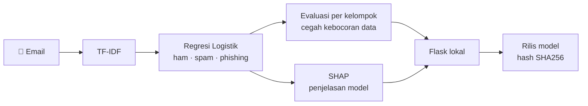
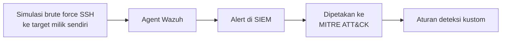

---

## 👋 Tentang saya

Saya tertarik pada keamanan siber: **bagaimana sistem diserang, diuji, dan dibangun agar tahan.**

Saya belajar dengan membangun: aplikasi web dan desktop, simulasi, dasbor IoT, lab SIEM, dan eksperimen keamanan, baik sendiri, dalam tim, maupun bersama tim yang saya bimbing. Di samping kode, saya memimpin tim teknis. Saya merencanakan dengan teliti, mendokumentasikan dengan jelas, dan menjaga keamanan sejak desain pertama.

> _Learning cybersecurity and secure software by building small, evidence-backed projects._

| 🔐 Cybersecurity | 🧱 Secure software | 🧭 Technical leadership |
| :-- | :-- | :-- |
| Secure SDLC, threat modeling, SAST / DAST, analisis phishing, lab SIEM | API backend, basis data, pengujian otomatis, CI | Memimpin tim teknis Hackathon hingga ratusan peserta |

---

## 🧠 Cara saya bekerja

| 🧾 Bukti dulu | 📏 Ukur sebelum dan sesudah | 🚧 Catat batasannya |
| :-- | :-- | :-- |
| Hasil diperlakukan sebagai hipotesis dan dicek manual. Tidak ada yang dicentang tanpa bukti. | Hardening Linux dinilai dengan audit sebelum dan sesudah perbaikan, bukan dengan perasaan. | Setiap lab mencatat kendala dan keterbatasannya, termasuk angka yang tidak layak dipercaya. |

---

## 📈 Sekilas dalam angka

<table>
<tr>
<td align="center"><h2>698</h2>peserta Hackathon Find IT! 2026 dipimpin sebagai Head of Technical</td>
<td align="center"><h2>58</h2>REST endpoint PassGo backend, Node.js + Express</td>
<td align="center"><h2>0,7919</h2>recall pada phishing modern vs 0,9467 di uji internal selisihnya adalah temuan utama</td>
<td align="center"><h2>95</h2>tes otomatis phishing-detection-ml 164 commit</td>
</tr>
</table>

---

## 🎣 Temuan utama: skor tinggi belum tentu bisa dipercaya

[**phishing-detection-ml**](https://github.com/ReyMindThink/phishing-detection-ml) adalah detektor email phishing yang saya bangun untuk mencari tahu **seberapa jauh angkanya sendiri bisa dipercaya**.

| Uji | Recall | |
| :-- | :-: | :-- |
| Uji internal (sumber sama dengan data latih) | **0,9467** | `███████████████████░` |
| 3.075 email phishing modern (2015 – 2025) | **0,7919** | `████████████████░░░░` |

Pada set eksternal berisi 60.648 email (MeAJOR), **4,28%** email biasa salah ditandai sebagai phishing.

> Skor tinggi pada pembagian data sendiri hanya sedikit bercerita tentang serangan baru. Jadi proyek ini mencatat selisihnya, bukan menyembunyikannya.

<b>Alur proyek</b>

---

## 🚀 Proyek

| Proyek | Peran | Isi | Status |
| :-- | :-- | :-- | :-- |
| 🎣 [phishing-detection-ml](https://github.com/ReyMindThink/phishing-detection-ml) | Peneliti dan developer (solo) | TF-IDF + regresi logistik, SHAP, aplikasi Flask, pytest, GitHub Actions, rilis model dengan hash SHA256 |  |
| 🧪 [security-lab](https://github.com/ReyMindThink/security-lab) | Pembelajar (solo) | Lab keamanan aplikasi dalam tiga fase: secure SDLC, honeypot dan detection engineering, IoT security (opsional). Belum ada temuan yang dipublikasikan | -d29922?style=flat-square) |
| 🎫 [PassGo](https://github.com/gadicandra/PassGo) | Team lead, backend | Platform tiket untuk komunitas kreatif: kuota tidak bisa terlampaui, QR unik per tiket, validasi di pintu masuk. Node.js, Express, MongoDB, Midtrans Snap, Supabase Storage | -0e75b6?style=flat-square) |
| 🚦 [Simulasi perempatan](https://github.com/ReyMindThink/simulasi-perempatan-mm-ugm) | Pencetus ide, lead developer | Simulasi berbasis agen (Python, Mesa, Streamlit) yang membandingkan dua aturan belok kiri. Hasil awal: waktu tunggu rata-rata −25,5%, kendaraan lolos +26,1% |  |
| 🧾 [PatunganKu](https://github.com/ReyMindThink/PatunganKu) | Cloud dan software engineer | Aplikasi patungan: basis data dan penyimpanan struk (Node.js, Express, Prisma, SQL, Docker). Azure dan verifikasi struk dengan AI baru rencana |  |
| 🌱 [GreenRide](https://github.com/ReyMindThink/GreenRide) | Cloud dan software engineer | Aplikasi desktop pelacak jejak karbon perjalanan harian (C# .NET 8, PostgreSQL) |  |
| 🪵 [ALoRa](https://github.com/ReyMindThink/ALORA_ASC_MAN2PONOROGO) dan 🧫 [AMBER](https://github.com/ReyMindThink/AMBER_ASC_MAN2PONOROGO) | Mentor teknis, pembuat aplikasi web pemantau | Ide dan perangkat sensor adalah karya tim binaan untuk lomba ASC 2026. Bagian saya: mendampingi tim dan membangun dasbor (Vite, TypeScript, Gemini API / Firebase RTDB, Vercel) |   |

### 🔬 Isi repo [`cybersec`](https://github.com/ReyMindThink/cybersec) (dikerjakan November 2026)

| Lab | Yang dikerjakan | Label |
| :-- | :-- | :-- |
| 🛡️ [Wazuh](https://github.com/ReyMindThink/cybersec/tree/main/labs/wazuh) | SIEM di Docker, simulasi brute force SSH ke target milik sendiri, alert dipetakan ke MITRE ATT&CK, satu aturan deteksi kustom |  |
| 🐧 [Hardening Linux](https://github.com/ReyMindThink/cybersec/tree/main/linux-hardening-audit) | Audit dengan SCA Wazuh (CIS Ubuntu 24.04) dan Lynis, perbaikan SSH, ukur sebelum dan sesudah |  |
| 🌐 [Analisis jaringan](https://github.com/ReyMindThink/cybersec/tree/main/labs/network) | Satu rekaman trafik SSH dibaca Wireshark, Suricata, dan Zeek, lalu dibandingkan |  |
| 📘 [Playbook phishing](https://github.com/ReyMindThink/cybersec/tree/main/incident-response-playbook) | Playbook insiden (acuan NIST SP 800-61 Rev. 3, MITRE T1566) dan satu aturan Sigma yang divalidasi sintaksnya |  |

<b>Alur lab Wazuh</b>

> 🔒 Semua pengujian dilakukan pada mesin atau container milik sendiri.

---

## 🧭 Kepemimpinan teknis

| Peran | Cakupan | Skala |
| :-- | :-- | :-- |
| **Head of Technical Division**, Find IT! 2026 (Hackathon) | Memimpin 6 orang. Mengubah Hackathon dari tugas bawa pulang menjadi maraton coding 24 jam di lokasi, lengkap dengan dokumentasi teknis, matriks penilaian, juri, dan penanganan krisis | 179 tim · 698 peserta · panitia 140 orang |
| **Technical Division**, Find IT! 2025 (Hackathon) | Konsep dan alur, guidebook, ToR, matriks penilaian, juri, sesi pitching | 84 tim · 248 peserta |
| **Technical Division**, Technocorner (IoT) | Format dan panduan lomba, form penilaian, final offline, koordinasi juri | 32 tim · 96 peserta |
| **Mentor teknis**, ASC 2026 (teknologi tepat guna) | Mendampingi dua tim dari ide sampai prototipe bertema aksi iklim: sensor suara penebangan liar dan biofilter mikroalga | 2 tim · 2 prototipe |

---

## 🧪 Teknologi

**🔐 Keamanan**

**💻 Bahasa dan data**

**⚙️ Membangun dan merilis**

**☁️ Cloud, jaringan, IoT**

---

## 📜 Sertifikasi

| Sertifikasi | Penyelenggara | Waktu |
| :-- | :-- | :-- |
| CCNA: Introduction to Networks | Cisco Networking Academy | Jun 2026 |
| AWS re/Start | Orbit Future Academy, Jakarta | Des 2025 |
| Lima sertifikat Python untuk data dan ML (statistika, deep learning, cleaning data, EDA, reduksi dimensi), 50 jam | DataCamp | Okt 2025 – Sep 2026 |
| Python, Gen AI dengan Microsoft Azure, data science dengan Microsoft Fabric | Dicoding | Des 2025 – Jun 2026 |
| Tiga sertifikat data science dengan R | DQLab | Des 2024 – Jan 2025 |

---

## 🌱 Sedang saya pelajari

| Topik | Lewat |
| :-- | :-- |
| 🕸️ Pemindaian dan pengujian web: Nmap, Burp Suite | Latihan terpandu |
| 🔍 Forensik dan SIEM lain: Splunk, Elastic | Latihan terpandu |
| 🍯 Honeypot dan detection engineering | Fase 2 [security-lab](https://github.com/ReyMindThink/security-lab) |

---

## 📊 Jejak aktivitas

---

## 🤝 Mari terhubung

Saya sedang mencari **magang di bidang cybersecurity atau secure software**. Kalau ingin berdiskusi tentang proyek, atau mencari kandidat magang yang memimpin dan membangun, silakan hubungi saya.

